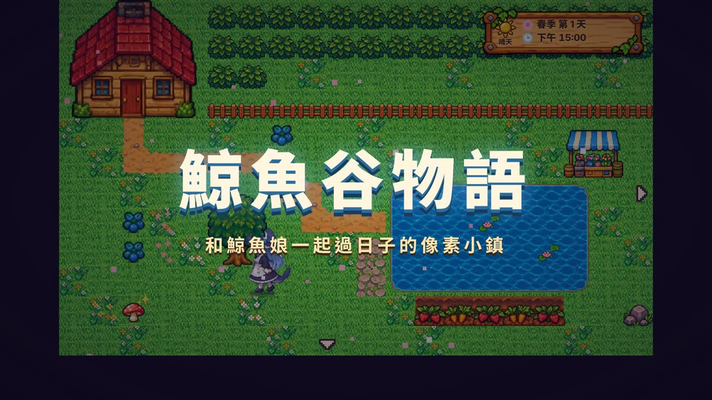
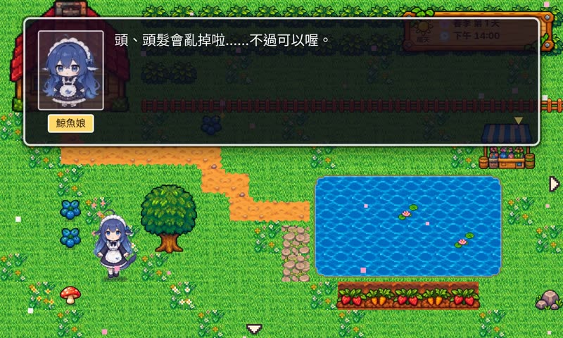
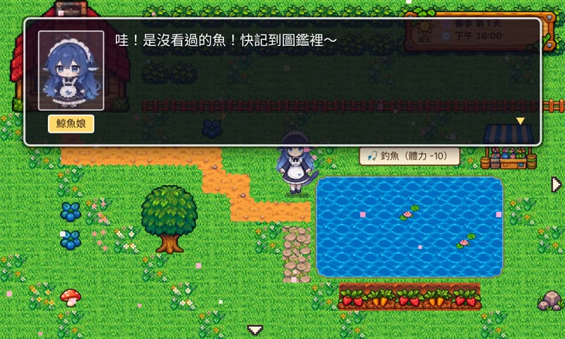
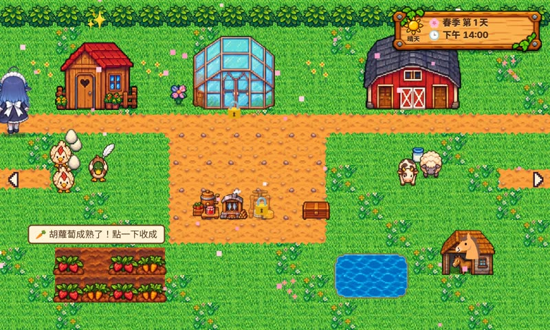
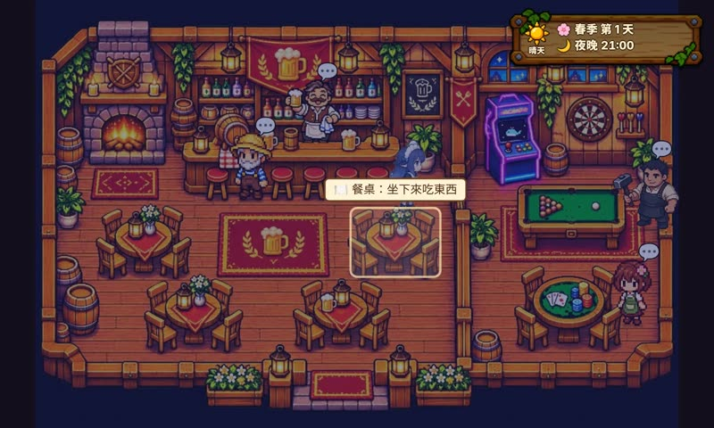
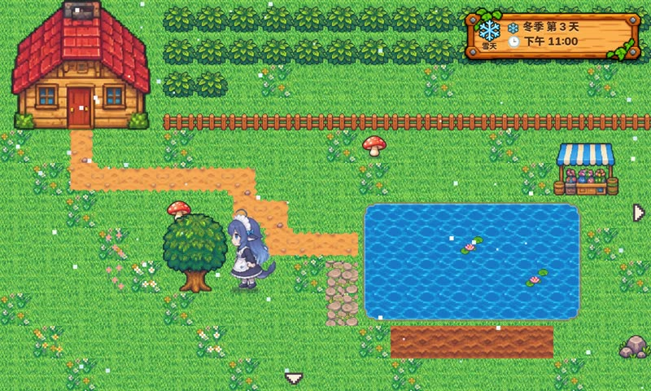
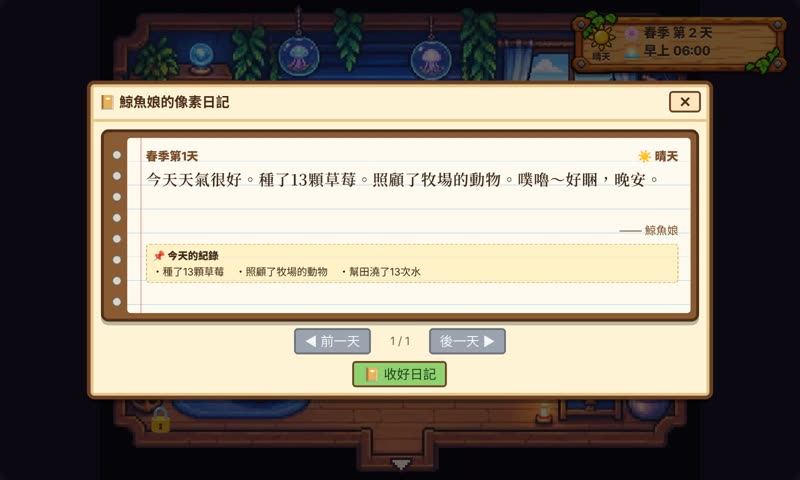

<div align="center">

# 🐋 鯨魚谷物語

**和鯨魚娘一起過日子的像素小鎮**

釣魚 · 種田 · 牧場 · 小鎮居民 · 酒館 · 四季天氣 · 睡前日記 · AI 對話 · 串門與交易 · 繁／简

[](LICENSE)
[](#-裝進-deepseek-harnessdsh-插件)




</div>

她有自己的作息：早上待在房間、下午去花園、傍晚散步、晚上回家睡覺。
你不用操控她，點她說話、陪她釣魚種田、帶她去鎮上逛逛，晚上一起去酒館坐坐。
每天睡前，她會把今天和你一起做的事寫成一篇小小的像素日記。

> 🎨 美術素材大多是 **AI 生成**（ChatGPT、豆包），來源與授權見 [ASSETS.md](packs/whale-girl-pixel/ASSETS.md)。

## 📸 畫面

| | | |
|:---:|:---:|:---:|
|  |  |  |
| **摸摸頭**　連點三下 | **釣魚**　18 種魚、湖中女神 | **牧場**　種田、養雞養牛 |
|  |  |  |
| **酒館**　晚上大家都在 | **四季**　每 7 天換一季 | **日記**　睡前寫一篇 |

## ✨ 有什麼

| | |
|---|---|
| 🏡 **她自己生活** | 照時段在房間、花園、牧場、海邊、小鎮之間移動；點她說話，連點三下摸摸頭 |
| 🎣 **釣魚與圖鑑** | 不同季節、天氣、時段釣到不同的魚；集滿一組有獎勵；還有湖中女神 |
| 🌱 **種田與牧場** | 播種、澆水、灑水器、收成；雞鴨牛羊會長大、會生產；加工機器做果醬、燻魚 |
| 🏘️ **小鎮** | 花店小葵、鐵匠阿綱、漁夫老陳、酒館老闆老吳；任務、節慶、告白結婚 |
| 🍺 **休閒** | 酒館猜硬幣、打牌；廚房吃飯、浴室泡澡游泳、遊戲室打電動；擺家具 |
| 🌦️ **四季天氣** | 跟現實時間同步；晴天、雨天、雷雨、雪天；櫻花、螢火蟲、落葉、雪花 |
| 📔 **日記與小願望** | 每天一個小願望；睡前自動寫日記（有 AI 時由 AI 改寫） |
| 💬 **AI 對話**（選用） | 接 DeepSeek，她會看著時間、天氣、體力、心情說話；記得最近 3 輪對話 |
| 🏡 **串門** | ⚙️ 設定產生「邀請碼」貼給朋友，朋友就能來你的農場逛逛、幫你澆水、留一封信 |
| 🏪 **交易所** | 今日市集；把東西擺上自己的攤位、傳攤位碼給朋友買；寵物也能用領養碼送給朋友 |
| 🗨️ **聊天室** | 目前是本地模擬（鎮上的居民和旅人會回你），之後可以接伺服器；有髒話過濾 |
| 🌏 **繁體／简体** | ⚙️ 設定切換，連用語一起換（存檔→存档、網路→网络） |

## 🚀 開始玩

### 🎮 直接玩（免安裝）

1. 到 [Releases](https://github.com/long432120-blip/dsh-whale-valley/releases) 下載 `鯨魚谷物語-試玩版-v0.22.zip`
2. **整包解壓縮**（直接在壓縮檔裡打開會沒有音樂）
3. 雙擊 `鯨魚谷物語.html`，用 Chrome 或 Edge 開

存檔在你自己的瀏覽器裡，每個動作都會自動存檔。玩法說明在 `怎麼玩.txt`。

### 🧩 裝進 DeepSeek Harness（DSH 插件）

```sh
# 方法 A：Release 的套件檔
dsh plugin --profile web add ./dsh-whale-valley-0.22.0.tgz

# 方法 B：直接從 GitHub（repo 已附編譯好的 lib/，不用另外建置）
dsh plugin --profile web add github:long432120-blip/dsh-whale-valley
```

裝好後重開 `dsh web`，她會出現在 DSH 視窗的浮層裡。DSH 的模型可以用兩個工具：
`whale_pet_status`（看她的狀態，唯讀）和 `whale_pet_act`（只開放餵食、澆水、收成）。

- 支援的 DSH 版本：`>=0.2.1-rc.5 <0.3.0`（DSH 還在 Developer Preview，介面可能變動）
- 從舊版 `dsh-whale-pet` 升級：先 `dsh plugin --profile web remove dsh-whale-pet` 再裝；舊存檔會自動沿用

### 💻 從原始碼跑

需要 Node.js 22 以上。

```sh
git clone https://github.com/long432120-blip/dsh-whale-valley.git
cd dsh-whale-valley
npm install
npm run demo              # 打開 http://localhost:8080/demo/pixel.html
```

改了 JSON 或地圖，重新整理頁面就生效。網址加 `?dev`（例如 `pixel.html?dev`）會出現「快轉 3 小時、跳到明天」這些開發者按鈕。

## 💬 AI 對話與 API Key

AI 是**選用**的：沒有 Key、斷網、10 秒沒回應、Key 錯了，她都會自動改說內建台詞，遊戲不會卡住。

| 版本 | Key 放哪裡 | 誰看得到 |
|---|---|---|
| 單機版 | 遊戲側邊欄 🔑（鍵盤 I）自己填，存在**你自己瀏覽器**的 localStorage | 只有你這台電腦；只會送到 `api.deepseek.com` |
| DSH 插件 | DSH 內建模型（不用另外申請），或 DSH 插件設定 `ai.apiKey`、環境變數 `DEEPSEEK_API_KEY`、存檔資料夾裡的 `.env` | 只有 host 讀得到，**永遠不會送到瀏覽器** |
| 開發用 `npm run demo:ai` | 專案根目錄的 `.env`（照 `.env.example` 複製） | 只在本機 `127.0.0.1` 的開發伺服器 |

> 🔒 程式碼裡沒有任何 Key。`.env` 已經在 `.gitignore` 裡；發布前可以跑 `npm run check:secrets` 再確認一次。
> 公用電腦不要填 Key；不玩了可以在 🔑 設定按「清除 Key」。

## 🛠️ 自訂：改 JSON 就能改遊戲

所有內容都在角色包 [`packs/whale-girl-pixel/`](packs/whale-girl-pixel/)，**不用改程式**。改完重新整理就生效；
`npx tsx scripts/check-pixel.ts` 會檢查有沒有打錯 id、漏欄位。

| 檔案 | 管什麼 |
|---|---|
| `character.json` | 名字、走路速度、作息（幾點去哪）、**台詞** |
| `gameplay.json` | 物品、作物、商店、好感等級、加工、解鎖、節慶、日曆 |
| `fishing.json` | 魚的種類、價格、在哪裡什麼時候釣得到 |
| `weather.json` | 天氣種類與每一季的機率 |
| `scenes.json` | 場景、背景圖、出口、季節粒子、時間木牌 |
| `interactables.json` | 背景圖上可以點的地方（床、冰箱、街機…） |
| `animals.json`、`pets.json` | 牧場動物、寵物 |
| `quests.json`、`wishes.json` | 任務、每天的小願望 |
| `diary.json` | 日記的句子範本 |
| `ai.json` | AI 的角色設定、規則、記憶輪數、防抖 |
| `social.json` | 交易所、攤位價格範圍、領養冷卻、串門與信箱、聊天室的居民回覆與敏感詞 |
| `locales/*.json`（專案根目錄） | 介面文字（繁體、简体）、兩岸用語對照 |
| `stats.json`、`leisure.json`、`tavern.json` | 體力飽食、摸摸頭與休閒、酒館 |
| `maps/*.tmj` | 用 [Tiled](https://www.mapeditor.org/) 畫的地圖 |

<details>
<summary><b>例 1：加一句台詞</b>（<code>character.json</code> 的 <code>lines</code>）</summary>

```jsonc
{ "text": "晚上的魚缸亮晶晶的，陪我看一下好不好？", "scenes": ["room"], "phases": ["night"], "action": "happy", "weight": 2 }
{ "text": "是河豚！主人最懂我了～", "on": ["feed"], "items": ["fish_puffer"] }
{ "text": "有主人在，每天都好開心。", "minAffection": 330 }
```

條件都是選填：`on` 什麼時候說（預設 `click` 點她；還有 `feed` 餵食、`caught` 釣到、`harvest` 收成、`levelup` 好感升級…）、
`scenes` 場景、`phases` 時段（morning／afternoon／evening／night）、`items` 針對哪些物品、`minAffection` 好感門檻；
`weight` 越大越常說；`action` 是說話時的動作。
</details>

<details>
<summary><b>例 2：加一種作物</b>（<code>gameplay.json</code> 的 <code>crops</code>）</summary>

```jsonc
{
  "id": "carrot", "seed": "seed_carrot", "seasons": ["spring", "autumn"], "staminaCost": 5,
  "stages": [
    { "name": "剛播種", "emoji": "🟫", "atMinutes": 0 },
    { "name": "發芽",   "emoji": "🌱", "atMinutes": 60 },
    { "name": "成熟",   "emoji": "🥕", "atMinutes": 180 }
  ],
  "harvest": { "item": "crop_carrot", "min": 1, "max": 3 }
}
```

種子和收成物（`seed_carrot`、`crop_carrot`）要在 `items` 裡也定義；想讓商店賣種子，加進商店清單。
</details>

<details>
<summary><b>例 3：加一種魚</b>（<code>fishing.json</code>）</summary>

```jsonc
// items：魚本身
{ "id": "fish_bass", "name": "鱸魚", "emoji": "🐟", "category": "fish", "price": 40,
  "description": "肉很結實，鯨魚娘的日常主食。", "food": { "satiety": 25, "affection": 3 } }
// fishing.tables.pond：在池塘釣得到；條件選填
{ "item": "fish_bass", "weight": 30, "seasons": ["summer"], "phases": ["evening"], "weather": ["rainy"], "minAffection": 150 }
```
</details>

<details>
<summary><b>例 4：調天氣、調好感速度</b></summary>

```jsonc
// weather.json：每一季各種天氣的權重（0 = 不會出現）
"winter": { "sunny": 6, "rainy": 0, "storm": 0, "snowy": 4 }

// gameplay.json：每天最多加多少好感、各等級門檻
"affection": { "dailyCap": 20, "levels": [ { "min": 0, "name": "初次見面" }, { "min": 50, "name": "熟悉" }, … ] }
```

想看改了之後要玩幾天才能求婚：`npm run sim -- --days 60`（模擬三種玩家）。
</details>

想換成**自己的角色**、改地圖、加 mod，或想了解架構，請看 [開發文件](docs/開發文件.md)。

## 🧰 開發指令

| 指令 | 做什麼 |
|---|---|
| `npm run demo` | 開發用頁面（http://localhost:8080/demo/pixel.html） |
| `npm run demo:ai` | 同上，加上 AI 對話（讀 `.env` 的 Key） |
| `npm test` | 單元測試 |
| `npx tsx scripts/check-pixel.ts` | 檢查角色包 JSON 與地圖 |
| `npm run sim -- --days 60` | 數值模擬（金幣、好感曲線） |
| `npm run check:secrets` | 發布前檢查有沒有 Key、Token、個人 email、本機路徑 |
| `npm run build` | 打包 DSH 插件（`lib/`） |
| `npm run demo:standalone` | 產生單一檔案的試玩版 `demo/pixel-standalone.html` |
| `npm pack` | 產生 DSH 插件套件檔 `dsh-whale-valley-<版本>.tgz` |

```
packs/whale-girl-pixel/   角色包：JSON、地圖、圖片、音樂（改這裡就能改遊戲）
src/shared/               遊戲規則（host 和瀏覽器共用，純函數，有測試）
src/host/                 DSH 插件的 host 端：存檔、AI、工具
src/client/               畫面：像素舞台、面板、AI 設定、串門、聊天室、繁簡切換
locales/                  語言包（繁體、简体）與繁簡對照表
demo/                     單機版與開發頁面
scripts/                  建置、檢查、模擬
test/                     單元測試
docs/                     開發文件、各版本設計書
```

## 🤝 回報問題、參與

- 遇到 bug 或有想法：開 [Issue](https://github.com/long432120-blip/dsh-whale-valley/issues)，附上瀏覽器、做了什麼、看到什麼
- 送 PR 前請跑 `npm test` 和 `npx tsx scripts/check-pixel.ts`；改了 `src/` 要重跑 `npm run build`（`lib/` 不要手改）

## 📄 授權

- **程式碼、Tiled 地圖、程式畫的臨時圖塊**：[MIT](LICENSE)
- **美術與音樂**：不在 MIT 範圍內。可以隨本遊戲散布、遊玩、直播和錄影；單獨拿去用請先聯絡作者。見 [ASSETS.md](packs/whale-girl-pixel/ASSETS.md)
